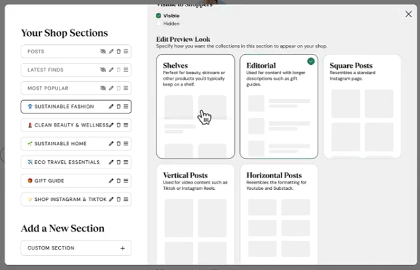
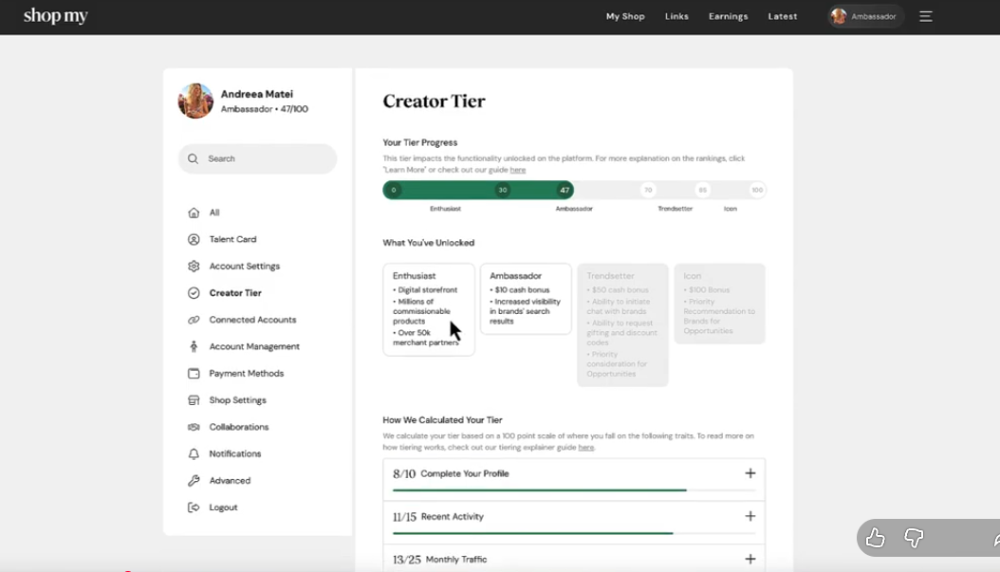

# Loja de creator/afiliada e fotos de perfil

Implementação iniciada em 13/11 e consolidada em 14/11/2026. Incremento 38 do [PRD](PRD-DIDEROT.md). Creator e afiliada usam a mesma identidade e perfil; nenhuma preferência concede privilégio de marca ou administrador.

## Acessar e configurar

1. Entre em `/demo` como creator, ou use sua conta com perfil profissional salvo.
2. No painel do creator, abra **Gerenciar minha loja** em `/painel/criador/loja`.
3. Em **Loja e perfil**, escolha a foto, nome público, endereço, bio e redes. Instagram, TikTok e YouTube vêm como campos iniciais; é possível adicionar outras redes, remover e ordenar até dez links. Endereço vazio da rede não é exibido.
4. Salve o perfil. O endereço da loja é exclusivo, tem 3–50 caracteres e fica permanente após a primeira publicação, preservando os links compartilhados.
5. Em **Produtos**, cadastre nome, marca/loja, categoria, preço opcional, destino HTTPS, foto, recomendação e indicação de link de afiliado informado pela própria pessoa. Também é possível selecionar itens do catálogo demonstrativo.
6. Em **Posts**, crie título, legenda, foto e escolha um ou mais produtos associados.
7. Em **Coleções e seções**, escolha nome, descrição, conteúdo e visual. Formatos: Prateleiras, Editorial, Posts quadrados, Posts verticais e Posts horizontais. Há edição, duplicação, ocultação, ordenação e remoção; ordem do conteúdo possui botões acessíveis.
8. Use **Pré-visualizar loja** para conferir a composição privada. Ao **Publicar loja/Publicar alterações**, confirme a exposição dos dados e imagens visíveis. **Ver minha loja** abre `/loja/[slug]` em nova aba. **Retirar loja do ar** preserva o rascunho e bloqueia novas consultas públicas.

A foto aparece no topo da loja. Depois de nome e bio vem **Explore minhas escolhas**; as redes sociais são o último elemento do cabeçalho, logo abaixo desse botão, na ordem definida pela creator. Links abrem em nova aba, com nome acessível e proteção de abertura.

Salvar modifica o rascunho completo; não altera silenciosamente a versão pública. Para atualizar uma loja já publicada ou sua foto, publique novamente. Operações só anunciam confirmação após RPC e releitura com versão correspondente. Formulários abertos precisam ser salvos ou cancelados antes de trocar de área. Erros preservam campos; conflito entre sessões pede releitura. Há proteção de saída/reload do navegador quando disponível; não há recuperação local/autosalvamento dos campos abandonados por navegação interna.

## Fotos de creator, afiliada e marca

Foto de creator/afiliada fica acessível no perfil profissional e no editor da loja. O perfil profissional precisa existir antes de vincular a imagem. Marca troca sua foto no cartão da organização em `/painel/marca`; responsável edita, membro consulta. Não foi criada uma página pública de marca neste incremento.

Aceita JPEG/PNG/WebP até 8 MB e 40 megapixels no cliente. O navegador reprocessa para WebP: perfil quadrado de 512 px; produto/post até 1.600 px, preservando proporção. Bucket privado admite somente WebP até 4 MB. Upload e vínculo são etapas distintas; falha de vínculo não é anunciada como foto salva. Salvamento/publicação aguardam os uploads do formulário. Remover desvincula a foto do cadastro, sem apagar um arquivo que possa estar em uma versão publicada.

Imagens não publicadas ficam privadas. Apenas mídias referenciadas no snapshot publicado são acessíveis a visitantes por URLs temporárias de até 15 minutos. Retirar publicação bloqueia novas autorizações; URLs já emitidas podem continuar válidas até expirar, e arquivos já baixados não são revogados. Uploads abandonados/substituídos podem permanecer privados; não foi criada limpeza automática destrutiva.

## Modelo, persistência e permissões

Migração aplicada: `20261113131815_creator_shops_media.sql`. Não modifica o catálogo legado, campanhas, perfis profissionais ou organizações existentes.

| Recurso | Contrato |
|---|---|
| `creator_shops` | Uma loja por usuário, slug exclusivo, documento de edição, snapshot público, versão e recibo da última requisição. RLS/SELECT somente do proprietário; sem escrita direta |
| Documento transacional | Até 200 itens, 50 seções, 100 posts, dez redes e 1 MB. Relações N:N por IDs locais e listas ordenadas, validadas atomicamente no RPC; não há tabelas relacionais separadas de itens/seções neste incremento |
| Itens externos | Recomendações pessoais com imagem/link/preço informado; não se tornam produtos canônicos da marca. Nenhuma busca remota de URL, compra ou cálculo de comissão |
| Itens do catálogo | Referência por slug publicado; servidor preserva nome, marca, preço e categoria canônicos. A creator edita recomendação e visibilidade, sem alterar o catálogo. Itens atuais são demonstrativos e não recebem link comercial inventado |
| Posts/seções | Referências precisam existir no mesmo documento; IDs duplicados e associações ausentes/alheias são rejeitados. Remover item/post ajusta vínculos; remover seção preserva seus itens |
| `profile_photos` | Creator: próprio usuário; marca: responsável pela organização. Membros autorizados leem a foto da marca. Escrita exclusivamente por RPC guardado |
| `creator_shop_public_media` | Índice fechado ao acesso direto; funções privadas consultam caminhos de mídia efetivamente publicados |
| `diderot-media` | Bucket privado, pasta inicial por usuário, sem sobrescrita de arquivos. RLS impede upload em pasta alheia e protege leitura privada; acesso público somente quando referenciado na publicação |
| RPCs | `save_creator_shop`, `save_profile_photo`, `get_public_creator_shop`; wrappers públicos INVOKER, operações guardadas em schema privado, search_path vazio e privilégios explícitos |

Publicação exige e-mail confirmado, perfil profissional e ao menos um item/post visível. Produtos externos visíveis precisam de imagem própria e destino HTTPS; posts visíveis precisam de imagem. Validam-se tipos, limites, IDs, referências, caminhos/posse de arquivos e protocolos. Snapshot exclui campos/itens/posts/seções ocultos e referências a itens ocultos. Foto e dados privados de perfil não são expostos automaticamente. Slug não pode ser alterado depois de publicado.

Versão esperada evita sobrescrita entre sessões. Pedido e conteúdo idênticos repetidos retornam o recibo sem duplicar ou avançar versão; reutilizar pedido com outro conteúdo é rejeitado. A retenção é do último recibo por loja, não de histórico completo de auditoria.

## Auditoria funcional

| Módulo | Rota | Funcionalidade | Estado real | Evidência / limite | Pendência |
|---|---|---|---|---|---|
| Creator/afiliada | `/painel/criador/loja` | Perfil público, foto e redes | Implementado, persistente | SHOP-01/03/04; SQL/Storage/API | Diretório público e aprovação comercial não incluídos |
| Marca | `/painel/marca` | Foto da organização | Implementado, responsável edita/membro lê | SHOP-05 e SQL de permissão | Página pública da marca ausente |
| Loja | editor | Produto externo ou seleção do catálogo | Implementado no escopo pessoal/demonstrativo | SHOP-01/02; SQL preserva canônico | Catálogo operacional de marcas/importação ausentes |
| Coleções | editor | CRUD, formatos, conteúdo N:N, ordem, visibilidade e cópia | Implementado | SHOP-01/02; SQL de IDs/associações | Arraste não incluído; botões acessíveis realizam ordenação |
| Posts | editor | Foto/legenda/produtos e edição/remoção | Implementado | SHOP-01; SQL/Storage | Upload de vídeo e publicação social externa não incluídos |
| Publicação | `/loja/[slug]` | Prévia privada, snapshot, republicação e retirada | Implementado | SHOP-02/04; SQL e API reais | Aprovação/moderação administrativa permanece pendente |
| Segurança | tabelas/RPC/Storage | Dono, membro, anônimo, sessão, versão e retry | Verificado no escopo dos testes | SHOP-03/05/06; SQL com rollback | Não equivale a auditoria integral de segurança |
| Celular | mesmas | Formulários, loja e redes abaixo do CTA | Chrome 390×844 e desktop 1440×1000 | Capturas e testes | Sem homologação física iOS/Android |

## Evidência e alcance

`supabase/tests/creator-shops.sql` passou com quatro identidades efêmeras e ROLLBACK: criação/releitura, retry, versão, alterações privadas sem mudar publicação, identidade canônica, URLs/valores/associações inválidas, fotos/Storage por dono, marca/membro, confirmação de e-mail, anonimato e retirada. Objetos Storage desse teste são metadados sintéticos, não uploads de arquivos reais. Uma expectativa inicial do fixture foi ajustada para aceitar o código real de conflito de versão na tentativa cruzada; a operação permaneceu bloqueada.

`scripts/seed-creator-shop-demo.mjs` verificou upload real de WebP privado, negação ao visitante antes de publicar, salvamento/releitura/retry real, publicação explícita e acesso anônimo ao snapshot/foto publicada. Criou somente a loja fictícia `clara-demonstracao` na identidade demo existente, com dois itens demonstrativos e um post ilustrativo. Não sobrescreve uma loja já existente. Os três links demo apontam às páginas iniciais das plataformas, não a contas pessoais fictícias apresentadas como reais. Não adicionou avatar falso: a pessoa pode escolher sua foto pelo formulário.

Os testes SHOP-01/02/03/05/06 simulam contratos de API e uploads, exercitando o reprocessamento de imagem no Chrome; SHOP-04 usa Auth, banco e loja pública reais em leitura. Gravação positiva de loja e arquivo foi exercitada pelo seed API; fotos de perfil têm autorização/releitura verificadas em SQL e fluxo de navegador simulado, sem gravar um retrato em conta real. Evidências resumidas em [banco/API](evidencias/loja-banco-api.json) e relatórios de interface registrados no progresso. Não somar rodadas distintas para afirmar auditoria integral.

Primeira rodada: **36 aprovados/4 falhas em 40 casos**, 125,9 segundos; SHOP-02/03 confundiram o alerta esperado com o anunciador interno Next. Corrigidos somente seletores, limitando-os à região principal. Revalidação em 14/11: **40/40 aprovados**, 246,5 segundos, sem skips/retries, computador/celular, incluindo regressão de marca e onboarding. [Inicial](evidencias/loja-interface-inicial.json) e [final](evidencias/loja-interface-final.json). TypeScript, dois testes do verificador documental e 190 links locais passaram. Build já aprovado; nenhuma alteração funcional posterior, apenas testes/documentação. Prévia local reaberta na porta 3002; frontend ainda sem novo deploy Vercel.

Primeira migração de avaliação falhou por geração incorreta de uma string de política; corrigida antes da aplicação efetiva, sem migração parcial. Advisors registram INFO intencional para a tabela fechada `creator_shop_public_media`, além dos avisos anteriores de convites e [proteção contra senhas vazadas desativada](https://supabase.com/docs/guides/auth/password-security#password-strength-and-leaked-password-protection). Não foram ampliadas permissões para eliminar esse INFO.

## Referências fornecidas e limites de produto

As imagens enviadas pela usuária orientam seções, layouts e navegação. São referências de interface, não prova de operação privada da ShopMy. Não foram criados tiers, ganhos, bônus, pontuação ou oportunidades fictícias a partir da segunda imagem.

Este incremento conclui a configuração e publicação da loja no escopo descrito. Afiliação financeira/rastreamento, vendas atribuídas, comissões, payout, moderação, diretório e catálogo de marca continuam pendentes. O site global ainda conserva a navegação/catálogo legado demonstrativo; a loja própria tem endereço separado. Nenhum e-mail, usuário preexistente ou serviço financeiro foi alterado por esta etapa.

## Apresentação revisada — 14/11/2026

Redes sociais aparecem apenas como ícones clicáveis abaixo do CTA, com nomes acessíveis. Perfis sem foto usam silhueta neutra. Produtos voltaram aos cards compactos do catálogo anterior (fotografia 4:5, marca, nome e preço; quatro colunas no desktop e duas no celular), com busca, filtros, ordenação e favoritos canônicos existentes. Os formatos das seções continuam organizando os posts; os cards de produtos mantêm a composição do catálogo.

Avisos de demonstração saíram da interface. Fixtures e suas marcações internas permanecem preservadas; a apresentação trata somente os textos conhecidos. Contas compartilhadas continuam identificadas como compartilhadas, e recursos indisponíveis recebem avisos objetivos. Não houve migração nem alteração automática de dados de negócio nesta revisão.

## Foto no perfil e navegação — 15/11/2026

Acesse Meu perfil em /conta/perfil para editar diretamente os dados e escolher a foto. Creator/afiliada reutiliza a mesma referência de creator da configuração da loja; marca responsável reutiliza a foto da organização. Foto salva é relida e atualiza a navegação privada. Para exibir a nova foto no topo da loja pública, abra Minha loja e publique as alterações: a publicação preserva a separação entre rascunho e conteúdo público.

As áreas de conta e painel têm navegação lateral no desktop e horizontal no celular, com atalhos funcionais para produtos, coleções e posts. A edição de produto/post/seção aberta precisa ser salva ou cancelada antes de trocar a área da loja. O seletor de arquivo possui área clicável, foco por teclado e aceita JPEG/PNG/WebP até 8 MB; conversão e autorização existentes permanecem. Shopper sem perfil profissional/organização não recebeu um tipo novo de avatar.

## Organização e criação — 18/11/2026

[Guia de referência](REFERENCIA-CONSTRUCAO-LOJA-SHOPMY.md) e [requisitos do incremento 43](PRD-DIDEROT.md#43-organização-da-loja-em-três-camadas--18112026). Seções são abas, coleções pertencem a seções e itens podem ser reutilizados em coleções. Menu + inferior abre produto por URL manual/catálogo/registros existentes, coleção, seção e post. Nova seção pode ser criada junto da coleção. Arquivar/restaurar mantém conteúdo privado; publicação exclui grupos ocultos/arquivados e seus conteúdos exclusivos. Prévia aplica as mesmas regras. Produtos do catálogo aceitam foto própria na loja sem alterar o catálogo. Entrada de foto passa a até 20 MB, com limites e tratamento HEIC descritos no PRD; a menção anterior a 8 MB é histórica. Salvar produto confirma por releitura; publicar atualiza a vitrine.
