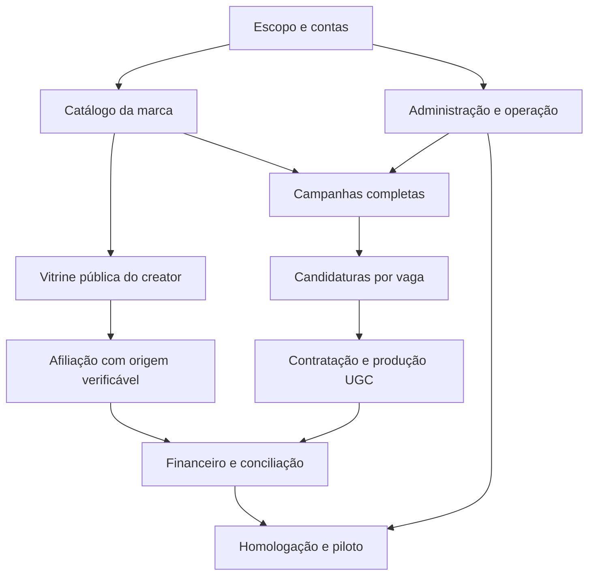

# Plano de lançamento do MVP Diderot

13/11/2026 · Complementa o [PRD](PRD-DIDEROT.md), o [progresso](PROGRESSO-DIDEROT.md) e o [mapa de telas/fluxos](TELAS-FLUXOS-SHOPMY.md). É uma sequência de dependências e critérios de saída, sem prazo ou percentual de conclusão inventados. O produto-alvo mantém shopper, creator, marca e administração; Creator Commerce e UGC são nativos.

## Ponto de partida confirmado

Existem home/catálogo público demonstrativo com fotografias ilustrativas, Auth e seleção de três tipos, onboarding/perfil, favoritos de visitante/conta, perfil profissional/serviços/portfólio privados, organização/equipe com permissões, rascunhos e três identidades demonstrativas. GitHub/Vercel/Supabase já têm integração e acesso público verificado em etapa anterior. As contas de demonstração compartilham dados fictícios; isso não comprova prontidão comercial.

Incrementos 37/38 ampliam o briefing privado e entregam loja própria com foto, redes, produtos/recomendações, coleções, posts, prévia e publicação. [Escopo da loja](LOJA-AFILIADA.md). Frontend novo local, banco/Storage aplicados; não confundir com publicação nova na Vercel. U07/U08 continuam parciais: catálogo vinculado, múltiplas vagas, elegibilidade e transições de campanha ainda faltam. Catálogo operacional de marcas, administração, candidatura, contrato, produção e financeiro não estão operacionais.

## 1. Fechar o contrato do MVP

Definir a promessa comercial de lançamento, o que fica habilitado para cada público e os critérios de aprovação/suspensão. Fechar papéis de equipe, revisão comercial, política de produto externo do creator, prazo de direitos, revisões/cancelamentos e quais remunerações serão suportadas. Escolher a operação de pagamento e a fonte de conversões antes de prometer comissões e ganhos rastreados. A escolha de provedor, cobrança ou integração paga não é feita implicitamente.

**Saída:** lista versionada de funcionalidades/limites, decisões abertas com responsável e critérios de aceite. A navegação não pode oferecer uma operação comercial que o backend ou a operação humana ainda não suportem. Se houver piloto restrito, seu escopo deve ser informado expressamente, sem anunciar todo o marketplace como lançado.

## 2. Concluir a entrada de contas reais

Validar cadastro, confirmação de e-mail, retorno correto, primeiro onboarding, entrada/saída, recuperação e nova senha em ambiente de teste autorizado. Preservar contextos acumulados da mesma identidade; shopper/creator/marca definem experiência, sem gerar privilégios por preferência. Tratar sessão expirada, conta não confirmada, erro/reenvio, cadastro duplicado e retorno após interrupção.

**Saída:** pessoa nova conclui as três jornadas sem ajuda, volta depois e reencontra seus dados. Confirmar entrega e uso do e-mail, não apenas retorno de sucesso da API. Testar móvel, isolamento, revogação e nenhuma promoção administrativa pelo formulário.

## 3. Transformar o catálogo demonstrativo em catálogo operacional

Marca autorizada cadastra/edita produto com imagem correspondente ao item, nome, descrição, categoria, loja/URL, SKU quando aplicável, variantes, preço/moeda, disponibilidade e origem. Regras de comissão e vigência só aparecem quando definidas e suportadas. Validar destino e mídia, deduplicar, salvar rascunho, revisar/publicar e pausar/arquivar sem apagar histórico. Registrar autor/mudanças relevantes.

**Saída:** produto criado por uma organização reaparece após nova sessão e, se publicado, pode ser descoberto/adicionado à vitrine; outra organização não consegue lê-lo/alterá-lo fora do escopo público. Importação CSV/feed/API pode entrar depois do cadastro manual, conforme contrato do MVP. Fotos ilustrativas da demo não podem ser anunciadas como prova de SKU, estoque ou oferta real.

## 4. Entregar a vitrine pública administrada pelo creator

Creator configura perfil público, foto/bio/redes, slug, coleções, ordem, recomendações e conteúdo ligado a produtos. Escolhe produtos do catálogo e altera seus textos editoriais sem modificar preço/estoque/comissão da marca. Prévia privada e publicação são ações distintas. Implementar estados de vazio, erro, pausa/indisponibilidade e atualização concorrente. Preservar links atuais da demo ao introduzir vários creators.

**Saída:** creator cria coleção, adiciona/ordena item, salva, publica e confere como visitante em outro contexto; alteração/retirada reflete na versão pública sem expor campos privados. Shopper encontra, filtra, abre, salva e reencontra o item. Relação produto–coleção/creator é N:N, sem duplicar produto canônico.

## 5. Abrir a operação administrativa mínima em paralelo

Criar acesso administrativo concedido por mecanismo privilegiado, filas e decisões com motivo, aprovação/reprovação/suspensão de marcas/creators/conteúdo, denúncias e auditoria. Definir responsáveis e canal de atendimento. Separar moderação, operação de organização e acesso financeiro; esconder botão não basta. Administrador também deve ter privilégios limitados à função.

**Saída:** operador autorizado consegue revisar e rastrear decisão; uma conta comum não entra, nem alterando URL ou payload. Administração é dependência para exposição comercial/moderação, não acabamento a fazer após a abertura. O teste histórico GAP-04 registra essa ausência.

## 6. Publicar campanhas completas e receber candidaturas por vaga

Concluir informações gerais, modalidades/vagas, requisitos, entregáveis, direitos, remuneração e revisão. Associar produtos reais do catálogo, permitir os grupos/vagas necessários e validar condições/prazos por vaga. Publicar somente com organização elegível, dados completos e autorização no backend; pausar/encerrar/arquivar possuem regras e histórico.

Depois, entregar descoberta/filtros/detalhe, candidatura por vaga, portfólio/apresentação/proposta, acompanhamento, seleção/rejeição com motivo e controle atômico de capacidade. Campanhas híbridas preservam condições próprias de cada modalidade; UGC admite zero seguidores e não exige postagem implicitamente.

**Saída:** marca publica, creator encontra e se candidata a uma vaga, marca avalia e ambos reencontram o estado correto. Reenvio não duplica, capacidade não estoura e inscrição encerrada/revogação impede ação. Salvar rascunho, aprovar candidatura e aceitar contrato são eventos diferentes.

## 7. Fechar contratação, produção e entrega UGC

Proposta/contrato/licença versionados, identificação das partes e aceites; mudança relevante pede nova concordância. Workspace privado com briefing, entregáveis, prazos, materiais e conversa. Upload com limites, validação, autorização e recuperação; versões não sobrescrevem arquivos anteriores. Marca comenta, solicita ajustes conforme escopo e aprova a versão final. Cancelamento/disputa têm motivo e histórico.

**Saída:** creator aceita, envia, recebe revisão e entrega; marca aprova com histórico acessível aos participantes. Outra conta não abre arquivo privado por URL. Aprovação de arquivo não concede direito novo nem confirma pagamento. UGC é remunerado separadamente de divulgação/comissão conforme acordo.

## 8. Entregar afiliação básica com origem verificável

Definir regra/vigência/precedência da comissão e janela de atribuição. Gerar links identificados por creator/produto/campanha, encaminhar ao destino correto e registrar eventos válidos sem duplicação indevida. Para anunciar vendas/comissões, integrar fonte de pedidos, atribuição, deduplicação e estornos. Mostrar fonte, período, fuso, moeda e última atualização. Identificar publicidade/link comercial no contexto da recomendação.

**Saída:** clique, pedido, atribuição, comissão provisionada e pagamento são comprovados como eventos separados. Sem fonte de pedidos, relatório deve dizer que não há conversões verificadas; cliques isolados não geram comissão. Se essa operação ficar fora de uma primeira versão restrita, remover a promessa comercial e registrar o recorte no PRD antes do lançamento.

## 9. Fechar financeiro e atendimento operacional

Escolher como cobrar/pagar, quem opera cada etapa e como comprovar liquidação, conciliação, falhas, cancelamentos e estornos. Separar produção, publicação, comissão, bônus e produto/gifting; valores em unidades mínimas e histórico de ajustes. Definir dados necessários, permissões, comprovantes e regras operacionais/fiscais/contratuais a serem revisadas pelos responsáveis. Dashboard não é saldo bancário ou comprovante de pagamento.

**Saída:** ambiente isolado cobre sucesso, recusa, repetição, devolução/estorno e conciliação, com permissões e recibos consistentes. Operação financeira em produção requer autorização própria posterior; esta etapa de desenvolvimento não a habilita. Operação manual, se escolhida para piloto, exige processo explícito e evidência real, sem simular pagamento automático.

## 10. Preparar operação, segurança e publicação final

Concluir termos/privacidade e regras de direitos/publicidade com responsáveis, suporte, logs sem segredos, tratamento de erros, monitoramento, limites de uso/abuso e plano de recuperação/backup. Validar uploads, sessão e acesso por objeto/organização; resolver achados confirmados e escolher lint/dependências compatíveis. Confirmar domínio/Auth, variáveis por ambiente, CI e procedimento de deploy/rollback. Fonte definitiva deve estar licenciada ou usar fallback permitido.

**Saída:** nenhum segredo/arquivo privado exposto, nenhuma operação privilegiada por preferência de cadastro, isolamento exercitado, alertas relevantes tratados, rollback e recuperação verificados. Configurar monitoramento ou passar build não equivale a comprovar recuperação. As configurações já existentes devem ser reaproveitadas.

## 11. Executar homologação completa e piloto controlado

Testar computador/celular com dados fictícios isolados e casos negativos, além de mocks. Encadear interface→API→banco→reentrada para cada jornada. Registrar commit, ambiente, dados de teste, resultado/falha e limitações, sem somar rodadas diferentes para declarar auditoria integral aprovada. Fazer avaliação acompanhada por usuária/participantes autorizados no mesmo escopo prometido.

**Gate de lançamento:** nenhuma falha bloqueadora ou crítica aberta nas jornadas incluídas, admin/operadores preparados, textos e operação revisados, dados de demonstração identificados e separados, plano de suporte/recuperação ativo e homologação da usuária registrada. Falhas históricas de funcionalidades excluídas só podem sair do gate por recorte de escopo explícito, nunca por ignorar teste silenciosamente.

## Dependências e ordem recomendada

A infraestrutura e a qualidade acompanham todos os blocos. Após briefing privado e loja pessoal entregues, seguir para catálogo operacional de marca e administração mínima → vinculação/publicação de campanhas/candidaturas → contratação/produção → rastreamento/financeiro conforme decisões de operação → homologação. Loja própria não substitui moderação, catálogo de marca ou afiliação financeira.

## Itens que podem ser avaliados após o núcleo, sem remoção silenciosa

App nativo, concierge semelhante ao Noir, recomendações algorítmicas/perfil de gosto, círculos avançados, ranking sofisticado, atribuição multi-touch, sincronização com várias lojas, relatórios avançados e automações extensas são candidatos a fases posteriores. Catálogo manual e links externos são uma fundação menor que integração multiloja. UGC/Creator Commerce e os gates de autorização/persistência não viram opcionais por essa lista; qualquer redução do MVP precisa decisão explícita.

Não há prazo confiável enquanto escopo comercial, pagamento, atribuição, direitos, operação de revisão e capacidade de execução permanecerem abertos. Após fechar essas escolhas e medir os primeiros incrementos completos, estimar por blocos com dependências e margem de correção, mantendo demonstração, piloto e lançamento comercial como marcos distintos.
