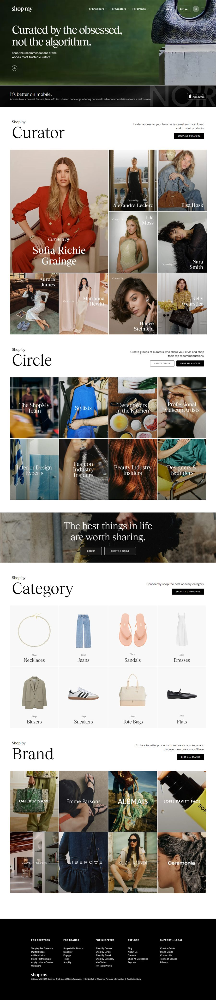

# Telas e fluxos — referência ShopMy e especificação Diderot

Versão 1.1 · 14/11/2026 · Anexo normativo da seção 35 do [PRD](PRD-DIDEROT.md). Referências e propostas permanecem distintas da implementação; incrementos 37/38 entregam briefing privado e loja própria nos limites documentados em [PROGRESSO-DIDEROT.md](PROGRESSO-DIDEROT.md).

## 1. Procedência e limites

O [documento de navegação fornecido](REFERENCIA-NAVEGACAO-SHOPMY.md) foi preservado integralmente. SHA-256 da origem e da cópia: `3CB0B6324C71708B51A725B01C512CAA376FFCE30D7158B12441D093EC79EE3F`. Ele relata duas navegações em vídeo, com horários, mas não contém os vídeos ou imagens das telas. Os links não permitiram reprodução nesta sessão. Portanto, os estados V2 abaixo são **relatados pela fonte secundária**, sem nova execução autenticada ou confirmação do backend ShopMy.

A investigação pública anterior pelo REA continua válida nos seus limites: [análise](../ANALISE-SHOPMY.md), [captura pública](evidencias/rea-publico.json), [formulários](evidencias/rea-formularios.json) e [shopper móvel](evidencias/rea-shopper-mobile.json). Cadastro concluído, portal de marcas, pagamentos e administração não foram observados integralmente. Não inferir APIs, tabelas, permissões ou algoritmos da ShopMy a partir de uma imagem.

## 2. Catálogo das telas da referência

| ID | Origem / tela | Elementos e ações relatados ou observados | Aplicação na Diderot / limite |
|---|---|---|---|
| REF-H01 | Captura de home fornecida e E0/E1 | Hero fotográfico, navegação por públicos, busca, Curator, Circle, CTA, Category, Brand e rodapé | Estrutura da home já adaptada; não prova existência de círculos pessoais ou concierge |
| REF-A01 | E2, seleção e login | Shopper/Creator/Brand, e-mail/senha e recuperar acesso | Três escolhas preservadas; envio não executado no REA |
| REF-S01 | E0, loja pública e produto | Perfil, coleções, busca aberta, grade; detalhe com galeria, outros curadores, ofertas e relacionados | Catálogo público demonstrativo existe; galeria/ofertas/múltiplos curadores pendentes |
| REF-S02 | E3, círculos e gosto móvel | Vazio de círculos; orientação de favoritar 25 produtos para gosto | Inspiração de estados; algoritmo e criação não testados; limiar de 25 não adotado |
| REF-V201 | [Vídeo 2 — 02:08](https://www.youtube.com/watch?v=Yh3vjXKOPdA&t=128s), vitrine pública | Grade de produtos e navegação da loja | NAV-C01/C02; conteúdo, estoque e ofertas devem ter origem explícita |
| REF-V202 | [Vídeo 2 — 03:20](https://www.youtube.com/watch?v=Yh3vjXKOPdA&t=200s), perfil | Cabeçalho e navegação do creator | Perfil público proposto; perfil profissional atual é privado |
| REF-V203 | [Vídeo 2 — 04:26](https://www.youtube.com/watch?v=Yh3vjXKOPdA&t=266s), seção looks | Conteúdo visual e grade de itens por seção | NAV-C02/C05; coleção não deve duplicar o produto canônico |
| REF-V204 | [Vídeo 2 — 05:33](https://www.youtube.com/watch?v=Yh3vjXKOPdA&t=333s), gerenciar seções | Modal de organização da vitrine | NAV-C02; nomes, ordem, visibilidade e acesso por teclado |
| REF-V205 | [Vídeo 2 — 06:40](https://www.youtube.com/watch?v=Yh3vjXKOPdA&t=400s), adicionar/editar item | Formulário com imagem e campos de produto | NAV-C03/C04; lista exata de campos Diderot definida abaixo, não atribuída à ShopMy |
| REF-V206 | [Vídeo 2 — 07:47](https://www.youtube.com/watch?v=Yh3vjXKOPdA&t=467s), conteúdo visual | Grade de conteúdo ligado a produtos | NAV-C05; não equivale à aprovação de entregáveis UGC |
| REF-V207 | [Vídeo 2 — 08:53](https://www.youtube.com/watch?v=Yh3vjXKOPdA&t=533s), seleção de produtos | Escolha de itens em grade | NAV-C03; seleção múltipla, duplicidade e confirmação são critérios Diderot |
| REF-V101 | [Vídeo 1 — 02:58](https://www.youtube.com/watch?v=uxgy0fjd8Gw&t=178s) | Comentário sobre disponibilidade de marcas; tela ShopMy não legível segundo a fonte | Não comprova catálogo, busca nem integração de marcas |
| REF-V102 | [Vídeo 1 — 14:52](https://www.youtube.com/watch?v=uxgy0fjd8Gw&t=892s) | Listagem/vitrine e discussão de afiliação | Contexto secundário; não comprova atribuição ou pagamento |

### Captura real fornecida da home

Prévia reduzida da captura enviada pela usuária, sem alteração do conteúdo. Original: `screencapture-shopmy-us-home-2026-11-12-13_53_56.png`, 1366 × 6301. Não é captura nova desta sessão. Os demais estados acima têm links para a fonte; **não há prints desses sete estados neste anexo**.

## 3. Decisões de conciliação obrigatórias

| Tema | Regra Diderot que prevalece | Consequência de implementação |
|---|---|---|
| Entrada | Shopper, creator e marca | Não remover shopper ao adaptar a entrada de duas opções da fonte |
| Identidade | Uma conta pode acumular contextos; preferência define destino inicial | Não conceder papel por seleção de formulário; consultar vínculo e autorização em cada operação |
| Creator | UGC, influencer e afiliado coexistem | UGC aceita zero seguidores; divulgar na própria rede não é exigência implícita |
| Campanha | Trabalho UGC/influencer/híbrido; afiliação é mecanismo comercial | Não criar quarta modalidade de trabalho só por haver comissão |
| Wizard | Sete etapas canônicas U08 | Os dez blocos de conteúdo da fonte cabem nas sete etapas; tabela na seção 7 |
| Participação | Candidatura por vaga, com condições próprias | Não aplicar um único requisito de audiência ou fee a toda campanha híbrida |
| Produto | Cadastro canônico da marca separado da recomendação pessoal do creator | Creator não edita preço, estoque ou comissão da marca; relações N:N |
| Prioridade | UGC permanece parte nativa do escopo-alvo | Sequenciar dependências não significa remover produção e direitos do produto |
| Equipe | Hoje responsável edita e membro consulta | Operador, financeiro e administrador são papéis futuros, sem concessão automática |
| Identidade visual | Tokens Diderot fornecidos; DM Sans, Reckless licenciada quando disponível | Fonte TRIAL não pode ser publicada; fotografias reais com procedência |

## 4. Requisitos de navegação e vitrine

| ID | Requisito proposto | Critério de aceite e teste futuro |
|---|---|---|
| NAV-C01 | Vitrine pública por creator com slug estável, foto, nome, bio e redes opcionais | Visitante abre apenas versão publicada; rascunho/contato privado não aparece em HTML/API; slug antigo redireciona quando houver mudança; preservar `/criador` demonstrativo |
| NAV-C02 | Coleções/seções com título, descrição, capa, posição e visibilidade | Proprietário cria, renomeia e ordena por botões e arraste; salvar, reentrar e verificar ordem pública; conflito de versão não sobrescreve outra sessão |
| NAV-C03 | Buscar catálogo e adicionar itens à vitrine | Busca paginada, filtros removíveis e contagem; selecionar IDs permitidos, rejeitar duplicação e item pausado; repetir pedido não duplica relação |
| NAV-C04 | Editar recomendação pessoal e adicionar URL externa quando política permitir | Legenda/título próprios não alteram produto da marca; URL válida, origem e divulgação comercial visíveis; erro mantém campos; publicação externa depende da política pendente |
| NAV-C05 | Conteúdo visual ligado a um ou mais itens | Foto/vídeo com alt/legenda, ordem e vínculos permitidos; excluir vínculo não apaga produto; arquivos privados de UGC nunca viram públicos automaticamente |
| NAV-C06 | Prévia e publicação explícitas da vitrine | Prévia privada mostra rascunho; publicar valida dados e moderação aplicável, confirma impacto, salva versão e relê público; salvar não publica |
| NAV-C07 | Pausar, retirar e recuperar itens sem perder histórico | Item pausado não aceita nova divulgação; regra visual informa indisponibilidade; referências de campanhas e eventos anteriores preservadas; restaurar exige autorização |
| NAV-C08 | Desempenho com origem e natureza da remuneração | Sem integração: “Sem dados”, nunca venda/comissão fictícia; com integração: período/fuso/moeda/fonte/última atualização e distinção clique/pedido/provisão/pagamento |

Estes IDs detalham C02/C03 e U20; não substituem U01–U21. Incremento 38 implementa NAV-C01/C02/C03/C04/C06/C07 no escopo de loja pessoal, catálogo demonstrativo e links externos; NAV-C05 cobre posts com foto e produtos, sem vídeo; NAV-C08/rastreamento continua pendente. Endereço é permanente depois de publicado, sem renomeação/redirect nesta versão. [Escopo e evidências](LOJA-AFILIADA.md).

## 5. Inventário de telas Diderot e contratos

As rotas com **proposta** são nomes de planejamento, sujeitos a revisão antes de criar arquivos. Ações só são concluídas com resposta válida, persistência/releitura e autorização. `E` = testes de evidência já existentes; `A` = aceite ainda por implementar.

| Módulo / rota | Tela, entradas e ação real | Persistência e permissão | Estado real / evidência ou aceite |
|---|---|---|---|
| Pública `/` | Home, menu, busca, curadores, seleções, categorias, marcas, CTA | Catálogo demo ou Supabase; somente leitura publicada | Implementada no escopo demo; E: testes de home/design existentes; foto não é oferta real |
| Pública `/criador`, `/colecoes/[slug]`, `/produto/[slug]` | Filtro, ordem, detalhe, favorito | Local visitante ou favorites por user_id; leitura pública | Implementada demo; E: auditoria de vitrine/favoritos; gestão e saída comercial ausentes |
| Acesso `/cadastro`, `/conta`, `/recuperar-acesso` | Tipo, e-mail/senha, login/saída local, confirmação e recuperação | Supabase Auth; não aceitar papel privilegiado no payload | Parcial: Auth e isolamento testados; entrega/retorno de e-mail real não validado |
| Acesso `/onboarding`, `/conta/perfil` | Três etapas: espaço, dados específicos, revisão | account_profiles próprio; creator/organização transacionais | Implementado no escopo documentado; E: experiencias-banco/API/interface |
| Demo `/demo` | Escolher shopper/creator/marca, entrar, acessar área e sair | Identidades fictícias reais compartilhadas; credenciais apenas servidor | Implementada/publicada; E: experiencias-vercel; não guardar dados pessoais |
| Shopper `/painel/shopper` | Perfil/interesses/favoritos, editar/remover e abrir item | Perfil próprio e favorites com RLS | Implementado; E: EXP-06 real e auditoria; migração de favoritos locais pendente |
| Shopper `/grupos`, `/meu-gosto` — proposta | Criar/editar grupo, escolher creators; explicação de recomendações | Propriedade e privacidade a definir | Pendente S10/S11; A: releitura entre sessões e teste de acesso cruzado, sem copiar algoritmo desconhecido |
| Creator `/painel/criador`, `/conta/criador` | Resumo e perfil profissional, modalidades, bio/categorias | creator_profiles próprio | Implementado privado; E: PAINEL-CREATOR; diretório público ausente |
| Creator `/conta/criador/servicos`, `/conta/criador/portfolio` | Ofertas e trabalhos por link; salvar/editar/remover | Tabelas privadas por creator, validações/RLS | Implementado nos limites dos módulos; upload/publicação ausentes |
| Creator `/painel/criador/loja` — aba Loja e perfil | Nome/bio, foto, redes, seções, prévia/publicar | Dono/versionamento e snapshot público | NAV-C01/C06 entregues no escopo; capa de loja não incluída |
| Mesma rota — Coleções e seções | Nome/descrição, ordenar, ocultar, copiar, associar itens/posts e visual | Relações N:N por IDs ordenados no documento atômico | NAV-C02/C07 entregues; sem upload de capa independente |
| Mesma rota — Produtos | Seleção do catálogo demo e cadastro externo/recomendação | Canônico somente leitura; item pessoal editável | NAV-C03/C04 entregues no escopo; catálogo de marca/importação ausentes |
| Mesma rota — Posts | Foto/legenda vinculadas a vários produtos e seções | Conteúdo próprio; não usa entregáveis UGC privados | NAV-C05 parcial: foto entregue, vídeo pendente |
| Pública `/criadores`, `/criadores/[slug]` — proposta | Diretório/perfil/vitrine; filtrar capacidade sem exigir audiência UGC | Apenas campos aprovados/publicados | Pendente U05/NAV-C01; A: dados privados ausentes e links antigos preservados |
| Marca `/painel/marca` | Organização, equipe/convites, rascunhos por modalidade/vaga | Owner escreve; membro lê; convites só destinatário decide | Implementado escopo privado; E: organizações/equipe/campanhas, RLS/SQL/HTTP |
| Marca `/painel/marca/catalogo` — proposta | Catálogo com busca/filtros/paginação e ações por item | Produtos por organização; permitir somente papel de edição confirmado | Pendente; A: outro tenant não lê/escreve; leitura de membro não habilita edição |
| Marca `/painel/marca/catalogo/novo`, `/[id]` — proposta | Formulário/previsão/rascunho/publicação e histórico | Produto canônico, variantes e auditoria | Pendente; A: campos/validações seção 6, atomicidade e concorrência |
| Marca `/painel/marca/importacoes` — proposta | CSV com prévia, linhas recusadas e reprocessar | Job por org, chave idempotente, resumo sem segredos | Pendente; A: arquivo inválido/parcial, encoding/limites, duplicidade e retomada |
| Marca `/painel/marca/criadores` — proposta | Diretório, filtros, lista e convite por vaga | Público aprovado + métricas privadas somente contexto autorizado | Pendente U05/U06/U09; não exibir estimativas como métricas verificadas |
| Marca `/painel/marca/campanhas/[id]` — proposta | Sete etapas, revisão, vagas/condições e publicar | Evolução dos rascunhos existentes, transações/versão/RLS | Parcial U07/U08; A: matriz seção 7 antes de permitir publicação |
| Pública `/explorar/campanhas`, `/campanhas/demo/[slug]` | Exploração e três briefings fictícios | Arquivo estático; sem vínculo automático com rascunho | Demo implementada; não anunciar candidatura ou campanha publicada |
| Marketplace `/campanhas/[id]`, `/painel/criador/candidaturas` — proposta | Condições por vaga, candidatar, acompanhar/retirar | Candidatura por vaga; creator próprio e marca da vaga | Pendente U09/U10; A: dupla submissão, capacidade, encerramento, motivo e isolamento |
| Contrato `/painel/contratacoes/[id]` — proposta | Negociação/aceites/termos e eventual envio de produto | Partes autorizadas, versões de termos e histórico | Pendente U11/U12/U17; mudança requer novo aceite |
| Produção `/painel/entregas/[id]` — proposta | Enviar versão, revisar, comentar, solicitar alteração e aprovar | Arquivos privados, URLs temporárias, prazos/direitos versionados | Pendente U13–U16; A: revisão não altera licença ou liquida pagamento |
| Relatórios `/painel/relatorios`, `/painel/links` — proposta | Links/cupons, cliques/pedidos, filtros e exportação | Escopo creator/org, fonte e atribuição verificadas | Pendente NAV-C08/U20; nenhum clique é convertido automaticamente em venda |
| Financeiro `/painel/financeiro` — proposta | Produção/publicação/comissão/bônus/produto discriminados | Ledger/reversões, função financeira futura e trilha | Pendente U18; provedor/contratos/fiscal/conciliação antes de produção |
| Admin `/admin` — proposta | Revisões, motivos, moderação, disputas e auditoria | Papel atribuído por operação privilegiada, nunca signup | Ausente; GAP-04 continua falhando; A: negação para shopper/creator/marca e trilha completa |
| Institucional `/sobre`, `/politicas` — proposta | Regras/contato e publicidade identificada | Conteúdo revisado; consentimento versionado quando necessário | Pendente; não simular aprovação jurídica ou canal de suporte inexistente |

## 6. Produto canônico, recomendação e importação

### Formulário da marca proposto

Identificação: nome, descrição, marca/organização confirmada, loja, SKU e URL canônica. Apresentação: imagem principal com alt, galeria, categoria e tags. Oferta: preço em unidade mínima inteira, moeda, preço anterior opcional, disponibilidade/estoque e variantes com SKU/URL próprios. Comercial: elegibilidade de afiliados, regra de comissão vinculada e vigência; não derivar comissão de um preço. Operação: status rascunho/ativo/pausado/arquivado, origem manual/importação e última atualização. Campos fiscais e dados pessoais não aparecem na vitrine.

Nome, imagem, categoria, URL comercial e preço/moeda válidos são mínimos para publicação proposta; rascunho pode estar incompleto com pendências explícitas. Validar campos no servidor/banco, tamanho/tipo de imagem, limites de texto, moeda suportada e integridade das variantes. URL deve usar esquema permitido, sem credenciais embutidas; eventual coleta remota precisa bloquear rede interna, revalidar redirecionamentos, limitar resposta/tempo e tratar destino indisponível. Nenhuma importação remota automática foi implementada.

Não descartar formulário em falha; não confirmar antes da releitura; informar conflito e permitir recuperar alteração. Duplicar cria novo rascunho sem reutilizar SKU conflitante. Pausar e arquivar exigem confirmação com impacto em links/campanhas. Nunca apagar histórico contratual/comercial. Comissão indefinida/zero deve ser explícita e não torna um item automaticamente afiliável.

### Inclusão pelo creator proposta

Buscar item ativo → conferir marca/loja/preço e condições comerciais → selecionar coleção → legenda/título próprios → salvar relação → prévia → publicação autorizada. Evitar múltiplas relações idênticas; um item pode integrar várias coleções. Creator altera seus campos editoriais e ordem, sem permissão para mudar estoque/comissão/preço canônicos. URL externa, se aprovada como política, permanece identificada como recomendação sem validação da marca e sem promessa de comissão. Produto fora do catálogo não vira produto da organização por associação de nome.

### CSV e sincronização propostas

Upload → mapeamento de colunas → prévia validada → confirmação → processamento → relatório aceitos/recusados → correção/reprocessamento. Deduplicar por organização+loja+SKU ou URL canônica conforme regra explícita; não fundir tenants. Preservar origem, lote, autor, horário e erros por linha. Chave de idempotência e integridade atômica por item impedem duplicação em retry. Feed/API dependem de integração escolhida; falha de sincronização mantém último dado com indicação de desatualização. Estoque desconhecido não significa disponível.

## 7. Campanha: sete etapas U08 com todo o conteúdo da fonte

| Etapa canônica | Blocos da referência consolidados | Dados e gate de avanço propostos |
|---|---|---|
| 1. Informações gerais | Objetivo + briefing + produtos/oferta + datas | Organização, nome/descrição, objetivo/categoria, tom/mensagens/restrições, produtos e referências; candidatura/início/fim e cronograma coerente com fuso; rascunho parcial permitido |
| 2. Modalidades/vagas | Modalidade | UGC/influencer/híbrido, grupos, quantidades e orçamento por vaga; comissão é condição comercial |
| 3. Requisitos | Perfil do creator | Nicho/idioma/região/portfólio/habilidades; audiência apenas quando a vaga exigir divulgação; UGC sem mínimo de seguidores |
| 4. Entregáveis | Entregáveis | Vídeos/fotos, formatos/canais, quantidade, resolução/duração, roteiro/captação, prazo/revisões/brutos; postagem somente quando aplicável |
| 5. Direitos de uso | Direitos | Por vaga: uso/prazo/território/canais, imagem/voz, mídia paga/exclusividade e renovação; licença aceita separada da aprovação do arquivo |
| 6. Remuneração | Remuneração | Fee de produção/publicação, comissão, bônus e produto discriminados; vigência e condições explícitas, sem saldo ou cobrança automática |
| 7. Revisão/publicação | Revisão e publicação | Resumo integral, pendências, disponibilidade/orçamento, termos e confirmação; autorização novamente no servidor |

A fonte organiza dez assuntos: objetivo, modalidade, produtos/oferta, creator, briefing, entregáveis, direitos, remuneração, datas e revisão. Esta composição preserva os dez sem criar dois wizards. O incremento 37 acrescenta o editor privado de sete etapas e condições por grupo/modalidade em `/painel/marca`, além de produtos/referências por link. Catálogo vinculado, múltiplas vagas por modalidade, completude/elegibilidade e publicação continuam pendentes; conferir [escopo do módulo](CAMPANHAS-RASCUNHOS.md).

Estados-alvo: rascunho → revisão elegível → publicado → seleção → contratação → execução → concluído; pausas/cancelamentos possuem motivo e impacto explícitos. A transição exata depende das invariantes U07–U16. Publicar exige conta confirmada, autoridade organizacional e requisitos de aprovação comercial definidos. Escolher “marca” no onboarding não basta. Salvar rascunho não reserva dinheiro, publica oportunidade ou envia convite.

## 8. Jornadas completas e critérios de teste

1. **Shopper:** home → busca/filtro → vitrine → detalhe → salvar → login → favoritos da conta → sair/reentrar/reler. Cobrir local versus conta separadamente; eventual importação requer ação explícita e deduplicação. Sem varejista integrado, saída comercial deve permanecer identificada como indisponível.
2. **Creator:** cadastro → confirmação → onboarding de capacidades → perfil/serviços/portfólio → primeira coleção → buscar/adicionar produto → editar recomendação → ordenar → prévia → publicar → abrir como visitante → alterar/pausar → verificar releitura. Testar slug, campos privados ausentes, usuário alheio e conflito de versões. Etapas após portfólio estão pendentes.
3. **Marca:** cadastro → confirmação → organização → equipe autorizada → produto rascunho → revisão/publicação → campanha em sete etapas → vagas → publicação → selecionar candidatura por vaga → negociar/contratar → revisar entrega → confirmar obrigações → conciliar quando financeiro existir. Catálogo e etapas posteriores ao rascunho atual estão pendentes.
4. **UGC:** creator de zero seguidores encontra vaga UGC → verifica uso/fee/prazos → candidata por vaga → negocia/aceita versão contratual → produz/envia versão privada → recebe revisão → reenvia → aprovação → direito/licença conforme contrato → confirmação financeira distinta. Aprovar arquivo não concede direitos novos nem comprova pagamento.
5. **Afiliado:** selecionar item elegível → conferir regra/vigência/atribuição → gerar link único → publicar aviso comercial → registrar clique validado → receber pedido da fonte → atribuir/deduplicar → provisionar → tratar devolução/estorno → aprovar/liquidar com conciliação. Sem fonte de pedidos, mostrar cliques sem inventar conversões.
6. **Administrador:** entrar com privilégio operacional concedido fora do cadastro → fila → inspecionar evidências → aprovar/reprovar com motivo → verificar alteração auditada e efeito público → tratar denúncia/recurso. Testar tentativas de três contas comuns, acesso por ID e revogação de privilégio. Jornada inteira ausente hoje.

Para cada jornada futura: testar sucesso, entrada inválida, sessão expirada, acesso cruzado, falha de rede/banco, repetição de pedido e versão concorrente, reentrada em outra sessão e celular. Mocks verificam interface/contrato; fixtures isoladas com banco verificam persistência/permissão; nenhum dos dois isoladamente prova toda a jornada. Não usar dados reais ou pagamentos de produção.

## 9. Estados, acessibilidade e identidade

| Estado | Comportamento exigido |
|---|---|
| Carregando | Esqueleto/progresso com nome acessível; não anunciar vazio antes da resposta |
| Vazio | Explicar escopo/filtros; ação contextual permitida, sem métricas inventadas |
| Validação | Erro ao lado do campo e resumo anunciável, foco no primeiro erro; manter valores |
| Salvando | Uma submissão por vez, ação pendente identificada; idempotência cobre retry |
| Sucesso | Confirmar resultado persistido e destino; não confundir rascunho com publicação |
| Erro / offline | Mensagem concreta e tentativa segura; formulário preservado, nenhum fallback silencioso de dados |
| Sem permissão / sessão expirada | Impedir leitura/gravação no servidor; reautenticar sem revelar dados privados |
| Conflito | Informar outra alteração; releitura/recuperação, sem sobrescrita automática |
| Pausado / indisponível / desatualizado | Rótulo, impacto e data/fonte; não depender só de cor |

Reutilizar [design system](DESIGN-SYSTEM-DIDEROT.md) e [estrutura da home](HOME-ESTRUTURA-REFERENCIA.md). Fotografias reais com licença/procedência, proporção consistente, objeto visível e fallback textual; vetores ficam para ícones funcionais. Formulários com labels, foco visível, teclado, descrição de erro e áreas de toque adequadas. Modal devolve foco ao acionador; ordenar deve ter alternativa ao arraste. Tabelas de marca viram cards ou rolagem identificada no celular, sem esconder ação essencial. Validar 390 × 844 e 1440 × 1000, zoom/refluxo, contraste AA e movimento reduzido. Estes são critérios propostos, não laudo de conformidade executado nesta revisão.

## 10. Modelo incremental e acesso

Reutilizar Auth, account_profiles, creator_profiles/services/portfolio, organizações/membros/convites, campaign_drafts/slots e favorites existentes. Não executar o modelo sugerido como migração automática nem substituir `auth.users` por nova tabela `users`.

| Grupo futuro | Contrato e isolamento |
|---|---|
| Lojas, produtos e variantes | organization_id/loja, SKU/URL canônicos, moeda/preço, origem/status/versionamento; responsável edita, membros atuais leem somente conforme política revisada |
| Vitrine, coleções e itens | Propriedade creator, slug/publicação; vínculos N:N produto–coleção e conteúdo–produto; público vê snapshot aprovado, não rascunho |
| Social accounts | Canais e métricas com fonte/data/estado de verificação; dados autodeclarados identificados |
| Campanhas/produtos/vagas | Org e condições por vaga; manter integridade entre produto e tenant; orçamento estimado não é saldo |
| Candidaturas/contratos/entregáveis/versões | Candidatura por vaga; partes autorizadas e termos versionados; artefatos privados e auditoria |
| Regras comerciais/links/eventos/pedidos/atribuição | Creator/produto/campanha/vaga, fonte e vigência; unicidade/idempotência, estornos; não inferir pedido de clique |
| Ledger/pagamentos/faturas | Unidades mínimas, naturezas separadas, reversões, conciliação e permissão financeira própria; fora do escopo operacional atual |
| Auditoria | Ator, entidade, mudança, origem, horário e motivo sem segredos; preço/comissão/status/aceite/pagamento preservados |

Toda mutação verifica identidade e proprietário/organização no banco/servidor; esconder botão não é controle de acesso. Testar troca de org/ID, acesso de ex-membro e tentativa de promoção. Aprovação comercial, operador e financeiro são propostas. Retenção, moderação, direitos de imagem, consentimento publicitário e fluxo fiscal precisam definição antes da exposição comercial.

## 11. Rastreabilidade integral do documento fornecido

| Seção da fonte | Destino consolidado / decisão |
|---|---|
| 1. Síntese | PRD 1/16 e jornadas deste anexo |
| 2. Evidências | PRD 2 e catálogo REF; secundária não promovida a inspeção direta |
| 3. Oportunidade | PRD 16/18/20; afiliação separada da produção |
| 4. Objetivos/métricas | PRD 13 + NAV-C08; acrescentar tempo até primeira ação, publicação/link válido, campanhas/candidaturas/conclusão, rejeição/suporte; sem instrumentação ou meta inventada |
| 5. Papéis | PRD 9/22 e seção 3/10; papéis financeiros/operadores futuros |
| 6. Navegação | Inventário da seção 5, sem criar rotas prematuramente |
| 7. Cadastro | Incremento 34 + seção 3; preservar shopper e conta acumulando contextos |
| 8. Marca | Seções 5–8 e PRD U05–U18; portal é proposta, não observação ShopMy |
| 9. Novo produto | Seção 6, modelo e NAV-C03/C04/C07 |
| 10. Vitrine | NAV-C01–C07 e REF-V201–V207 |
| 11. UX/UI | Seção 9 e design system vigente |
| 12. Não funcionais | PRD 10/22 e seções 6/9/10; isolamento, auditoria, paginação, idempotência e sincronização |
| 13. Dados | Seção 10 e PRD 9/22; não duplicar Auth ou migrar campanha para candidatura genérica |
| 14. Aceite | Matriz de 14 critérios abaixo |
| 15. Prioridades | Seção 12; UGC permanece nativo e favoritos já existem |
| 16. Decisões | PRD 14 + pendências abaixo, sem inventar aprovação |
| 17. Referência visual | Seção 2; links por horário, sem prints inexistentes |

| Critério da fonte | Aceite consolidado | Estado atual |
|---|---|---|
| AC01 tipo/onboarding | Três tipos, destino correspondente, sem promoção | Implementado no incremento 34, respeitando limites de confirmação |
| AC02 e-mail/publicação/pagamento | Confirmação e elegibilidade antes de publicar/ativar | Publicação/financeiro ausentes; não declarar gate exercitado |
| AC03 perfil/vitrine | Perfil → coleção → item → prévia → publicação | Perfil privado existe; vitrine operacional pendente |
| AC04 link/comissão | Regra e rastreabilidade antes de publicar | Pendente NAV-C08/U20 |
| AC05 produto da marca | Validação completa e preview | Pendente catálogo operacional |
| AC06 preservar formulário | Erro não perde campos, recuperação clara | Critério do novo produto pendente; outros módulos têm seus testes próprios |
| AC07 campanha/remuneração | Modalidade/vaga/condições distintas, zero/indefinido explícitos | Rascunhos parciais, não campanha operacional |
| AC08 candidaturas | Por vaga, status, revisão e motivo | Pendente U10 |
| AC09 versões/direitos | Aprovar versão sem alterar licença automaticamente | Pendente U13–U16 |
| AC10 pausa/histórico | Bloquear nova divulgação conforme regra, preservar passado | Pendente NAV-C07 |
| AC11 relatório | Fonte/período/fuso/moeda/janela/atualização | Pendente NAV-C08 |
| AC12 isolamento | Org A não acessa B por URL/ID/API | Verificado nos módulos atuais; repetir para cada tabela/ação futura |
| AC13 auditoria | Preço/comissão/status/pagamento com histórico | Pendente para novos módulos; não presumir por haver timestamps |
| AC14 estados/responsivo | Carregando/erro/vazio/indisponível, celular e teclado | Parcial na vitrine demo; testar novos editores e publicação |

## 12. Ordem de entrega e decisões pendentes

| Prioridade | Próxima entrega | Dependências / gate |
|---|---|---|
| P0 | Consolidar PRD, contexto de desenvolvimento, fontes e verificações desta etapa | Documento preservado, links íntegros, instruções sem conflito; não lançar módulos novos |
| P0 | Validar cadastro/retorno de confirmação e recuperação em ambiente isolado | Provedor de e-mail, URLs de retorno e contas de teste aprovadas; não usar usuários reais |
| P1 | Completar briefing U08 e condições por vaga, mantendo rascunhos privados | Migração incremental, testes RLS/versão/atomicidade; nenhum botão de publicação antes do gate |
| P1 | Catálogo manual da marca + relações e editor de vitrine | Política de produto externo, modelo N:N, publicação/moderação e migração dos links demo |
| P1 | Administração mínima de revisão + descoberta/candidatura por vaga | Privilégio operacional seguro, regras de elegibilidade, U08 e estados auditados |
| P1 | Contratação/produção UGC com versões e direitos | Aceite de termos e partes, acesso privado; manter produção/publicação/remuneração distintas |
| P2 | Importação CSV, afiliação e relatórios com origem comprovada | Catálogo estável, regras comerciais e fonte de pedidos; métricas não fictícias |
| P2 | Financeiro, conciliação e integrações | Contratos/fiscal/provedor/escolhas comerciais aprovados; testes isolados antes de produção |
| P3 | Feed/API de loja, ranking/gosto/grupos e atribuição avançada | Política, privacidade, qualidade dos dados e operação básica concluída |

P0/P1 indicam sequência de trabalho, não prazo ou promessa de lançamento. Próximo incremento funcional recomendado: briefing completo por vaga, já iniciado no modelo atual. Catálogo/vitrine podem ser planejados em paralelo documental, sem dois escritores no mesmo banco/porta de teste.

Decisões da fonte ainda abertas: exigência de revisão por capacidade; precedência/vigência da comissão; primeira plataforma de loja; uso de cupons sem link individual; provedor/fiscal PF/PJ; audiência autodeclarada versus verificada; padrões e negociação de direitos UGC; publicação de produto externo pelo creator. Acrescentar política de slug/publicação/moderação, privacidade de grupos e migração explícita dos favoritos locais. Não escolher serviço pago ou regra jurídica nesta consolidação.

## 13. Gate desta etapa documental

Concluir esta etapa significa: preservar a fonte, catalogar telas com evidência e limite, conciliar decisões, mapear todos os assuntos/aceites, atualizar PRD/progresso e executar a verificação documental. Não significa que novos editores, telas propostas ou jornadas comerciais estejam implementados. Os números históricos de auditoria permanecem separados dos testes desta revisão.
