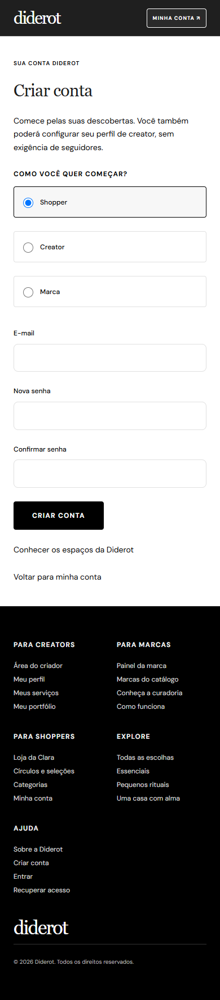
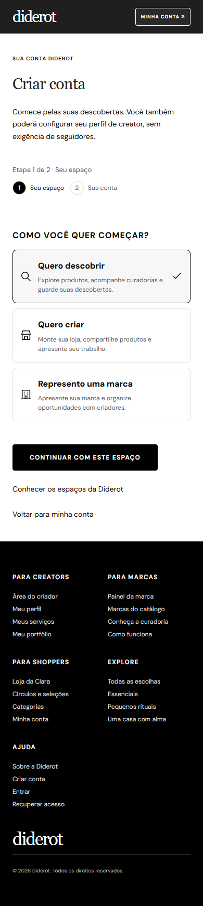

# Reformulação UX/UI — situação inicial e estratégia

18/11/2026. Pedido preservado em [referência](REFERENCIA-UX-OVERHAUL.md). Branch feat/ux-overhaul-2026-11-18, base 16a63fe202af985128bd0127cbc3e296c61c68e0. Nenhuma autorização para novo deploy em produção nesta tarefa; não atualizar main.

## Ambiente identificado

www.shopdiderot.com respondeu 200 com título Diderot — descobertas com intenção, Next e mesmo tamanho de HTML da URL canônica Vercel (85463 bytes); apex redireciona para www. A consulta Vercel ao projeto conhecido retorna 404 nesta integração, portanto a associação do domínio não foi confirmada por API. Conferência adicional de assets/hash documentada na evidência do ambiente. Repositório conhecido e branch preservados: marigranadoc/diderot-platform.

Next 16.4.6, React 19, TypeScript 7, CSS com tokens e fotografias existentes; sem biblioteca de componentes. Auth/REST/Storage Supabase já configurados. Toda escrita existente tem validações, RPC ou filtros por titular. Não mudar contratos/RLS/tabelas. [Arquitetura](architecture.md), [inventário automático de rotas, estados e contratos](evidencias/ux-inventario-inicial.json).

## Diagnóstico e jornadas

| Área | Disponível | Fricção identificada | Evolução incremental |
|---|---|---|---|
| Cadastro/onboarding | Auth com confirmação, três intenções, onboarding atômico/releitura | Intenção e senhas juntas; escolhas textuais; campos opcionais competem com essenciais | Seleção visual, conta em etapa própria e apresentação progressiva |
| Creator | Perfil/serviços/portfólio privados, loja publicada separadamente | Painel com contagens isoladas e pouca orientação; navegação horizontal no celular | Ação principal, checklist de dados relidos, barra inferior e atalhos |
| Loja | Hierarquia, rascunho/publicação, fotos, layouts, ordem, arquivo/restauro | Gestão por listas de botões; campos extensos; pouca prévia ao criar | Criação curta com prévia, cards, busca e ações secundárias |
| Marca | Organização/equipe/convites/rascunhos, membro leitor | Ferramentas dispostas como cadastro empresarial | Visão geral por tarefas, formulário curto e revisão |
| Shopper | Catálogo, filtros, favoritos locais ou de conta, lojas públicas | Busca sem limpar direto ou restauração completa na URL | Filtros compartilháveis/restauráveis, busca clara, vazio útil |
| Campanhas | Briefings de referência públicos; rascunhos privados reais | Descoberta sem filtros e dados extensos | Filtros dos campos existentes e blocos de informação |

Candidaturas/contratos/financeiro/tracking/raspagem não disponíveis. Círculos pessoais, catálogo operacional de marca e admin seguem no plano do MVP; sem atalhos fictícios. Produtos locais e campanhas públicas preservam sua procedência; não preencher métricas ou campanhas reais inventadas.

## Fundação e verificação

Preservar tokens preto/branco/neutros, tipografia editorial, DM Sans funcional, fotos e cards de produto. Reckless TRIAL continua local/ignorada. Criar apenas ícones SVG consistentes, seleção/ação/vazio/progresso/prévia reutilizáveis, sem novas dependências. Diálogos nativos e foco, validação/retry/guardas de sessão existentes mantidos. Movimentos CSS respeitam preferência reduzida.

Registrar capturas antes/depois em work/ux-before e work/ux-after; evidências sanitizadas em docs. Medir campos/etapas a partir das telas, sem estimar conversão. Testar os caminhos alterados e seis larguras (320/375/390/768/1024/1440), teclado e erros. Testes simulados não substituem escrita real; jornadas reais usam contas fictícias e leitura, sem alterar dados compartilhados. Cadastro SMTP real permanece fora da homologação atual.

## Decisões de implementação e limites

Ação Adicionar produto do painel abre diretamente os métodos disponíveis; Criar da barra inferior abre todas as criações. Novos produtos têm duas etapas, coleções três; edição de registro existente permanece direta. Não foi imposta uma etapa por campo. A organização e o perfil da marca usam prévia junto dos poucos campos, com opcionais recolhidos. Onboarding continua transacional: personalização da loja vem como primeira ação no painel, sem misturar o contrato de perfil com publicação de loja.

Arrastar usa HTML Drag and Drop no desktop e salva pelo RPC existente; subir/descer continua disponível nos menus e como alternativa no celular. Não alegar teste de gesto nativo em iPhone ou teclado virtual físico; a verificação usa Chrome em larguras distintas. Preview profissional/serviço/portfólio é privado e não implica diretório público ativo. Compartilhamento usa Web Share quando disponível e clipboard com confirmação; falha não exibe cópia concluída.

Guia público de referência consultado: [ShopMy Creator Guide](https://guide.shopmy.us/en/). A home ShopMy exige JavaScript no leitor de páginas; não foi afirmada nova observação de áreas autenticadas. Requisitos específicos vêm do documento fornecido e da implementação Diderot auditada.

## Alterações por módulo

| Módulo | Resultado implementado | Contrato preservado | Verificação |
|---|---|---|---|
| Cadastro | Intenção visual antes de e-mail/senha, voltar mantém valores | Auth signup/resend/recovery e confirmação | ONB, EXP, ACCESS, UX-01/03 |
| Onboarding | Seleção visual, opcionais recolhidos, revisão por perfil | complete_account_onboarding e releitura | EXP-01–03/07 |
| Navegação | Barra inferior, menu compacto, contexto consultado por vínculos, navegação interna | Preferência não concede privilégios | SHOP-08, UX-05/06 |
| Creator | Saudação, próximo passo, checklist de perfil/foto/loja/conteúdo e atalhos | Consultas próprias; nenhuma métrica fictícia | DASH, EXP-06 |
| Loja | Prévia inicial da loja existente, edição, compartilhar e confirmar publicação | Snapshot, versão, recibo, titular e mídias | SHOP-01–13 |
| Produtos | Essenciais → destino/prévia, foto clicável, campos avançados | Itens canônicos preservados e URLs pessoais | SHOP-09/10/13 |
| Coleções | Nome/seção → conteúdo visual → prévia, busca/filtros, menus/arquivo/restauro | Documento JSON, vínculos, layouts e ordem | SHOP-02/09/11/12 |
| Perfil | Prévia profissional, foto clicável, grupos de edição e guarda de saída | Perfis privados e foto pública por publicação | ONB-06–11, SHOP-08 |
| Serviços | Adicionar sob demanda, escolher tipo suportado, prévia e preço opcional | creator_services privado | SRV |
| Portfólio | Galeria por tipo, criação com link, detalhes recolhidos e prévia | creator_portfolio_items privado; sem upload novo | PORT |
| Marca | Atalhos por tarefas, apresentação com prévia, equipe/campanhas existentes | Titular editor, membro leitor, convites e rascunhos | BR, TEAM, CAMP |
| Campanhas | Busca/formato/categoria, prazo, detalhe hierarquizado e navegação integrada | Dados de referência; inscrições indisponíveis | EXP-04/06, UX-01 |
| Shopper | Busca com limpar e URL restaurável, vazio útil, favoritos e compartilhar loja | Favoritos locais vs conta continuam distintos | AUD, FAV, UX-02/04 |

## Comparação observada

Conta fictícia existente, Chrome móvel 390px. Contagem de controles expostos, excluindo os detalhes recolhidos; não representa quantidade total de dados armazenados. [Medições](evidencias/ux-comparacao-medida.json). Nenhuma gravação de negócio durante a coleta.

| Medida | Antes | Depois |
|---|---:|---:|
| Campos de credencial ao entrar no cadastro | 3 | 0 (aparecem na segunda etapa) |
| Campos expostos ao adicionar produto manual | 11 | 3 |
| Campos expostos ao criar coleção | 12 | 2 |
| Cliques do painel até o formulário manual de produto | 3 | 2 |

A criação completa do produto inclui a etapa de destino/prévia; a redução acima mede entrada na tarefa, não conclusão ou conversão. Coleções novas têm três etapas e edições existentes permanecem diretas. Não foram feitas pesquisas com pessoas usuárias ou medições de conversão.

## Antes e depois

Cadastro anterior:

Cadastro por intenção:

As comparações visuais de produto e painel autenticado permanecem no relatório local de revisão, sem inclusão no repositório público. As medições agregadas acima não contêm dados identificadores.

Capturas anteriores usam o domínio público e posteriores a prévia local, com as mesmas contas fictícias. Para comparação, as capturas finais renderizam o mesmo fallback Georgia nos dois ambientes. A fonte Reckless TRIAL permanece local/ignorada e seus binários não são publicados. Não foi atribuída ao redesenho uma mudança de fonte.

## Jornadas, limites e pendências

[Leitura real](evidencias/ux-jornadas-leitura.json): Auth e navegação das três contas fictícias, computador/celular, com bloqueio de escritas de negócio. Não foram criadas novas contas reais ou enviados e-mails. CRUD, erro, retry, troca de titular e releitura são exercitados por contratos simulados no navegador; provas históricas de banco com rollback permanecem válidas para os contratos inalterados, sem serem apresentadas como novo teste real nesta etapa. A nova chamada SQL de teste devolveu confirmação expirada, sem resultado de execução consolidado; não atribuir aprovação ao banco com base nela.

Candidaturas, contratação, tracking/comissões, pagamentos, administração, catálogo operacional de marcas e importação automática por URL continuam fora da reformulação. Homologar recebimento/clique de e-mail no domínio definitivo permanece pendente. Não há comprovação de teclado virtual/dispositivo iOS físico nem certificação WCAG; há testes em viewports, teclado de navegador e movimento reduzido. A produção deve permanecer na revisão atual até autorização explícita.

## Resultado final de verificação

Revalidação final: **92/92 aprovados**, 278.6 s, sem skips/retries/flaky. [Evidência final](evidencias/ux-revalidacao-final.json). Rodada ampla anterior: 220/224; as quatro falhas eram verificações antigas de DS/cópia e passaram nesta revalidação. Não combinar execuções para afirmar uma auditoria integral. Build e check passaram; navegação real em leitura das três contas, seis larguras e capturas revisadas.

História verificada: intenção/criação → payload existente → retorno confirmado/releitura → prévia/publicação, com simulação de erro e identidade no navegador. Backend de negócio inalterado; provas históricas de RLS/rollback não substituem homologação HTTP real de novas gravações nesta etapa. As jornadas com contas reais foram somente leitura e não enviaram e-mails.

## Código e acesso para revisão

[PR #1](https://github.com/marigranadoc/diderot-platform/pull/1), branch feat/ux-overhaul-2026-11-18, código 67b7b68. [Prévia Vercel](https://diderot-platform-git-feat-ux-overhaul-2026-11-18-mari-granado.vercel.app) com build Ready e login da equipe obrigatório; execução automatizada protegida não foi liberada. Use a prévia local na porta 3002 para a jornada já verificada. Produção segue no código anterior, com [assets inalterados](evidencias/ux-implantacao-revisao.json); sem merge/promote. A revisão automática recusou compartilhar temporariamente a implantação e publicar captura autenticada; os caminhos protegidos não foram contornados.

## Arquivos principais

- Entrada: [AccessForm](../components/AccessForm.tsx) e [AccountSetup](../components/AccountSetup.tsx).
- Navegação e interações: [ProfileWorkspace](../components/ProfileWorkspace.tsx), [ExperienceUI](../components/ExperienceUI.tsx), [AppIcon](../components/AppIcon.tsx) e [estilos](../app/experience.css).
- Creator/loja: [CreatorDashboard](../components/CreatorDashboard.tsx), [CreatorShopEditor](../components/CreatorShopEditor.tsx) e [ShopContentForms](../components/ShopContentForms.tsx).
- Perfil/ofertas: [CreatorOnboarding](../components/CreatorOnboarding.tsx), [CreatorServices](../components/CreatorServices.tsx), [CreatorPortfolio](../components/CreatorPortfolio.tsx).
- Marca/descoberta: [BrandWorkspace](../components/BrandWorkspace.tsx), [CampaignExplorer](../components/CampaignExplorer.tsx), [Catalog](../components/Catalog.tsx).
- Verificação nova: [testes UX](../tests/ux-overhaul.spec.ts), além dos módulos existentes atualizados no PR.
